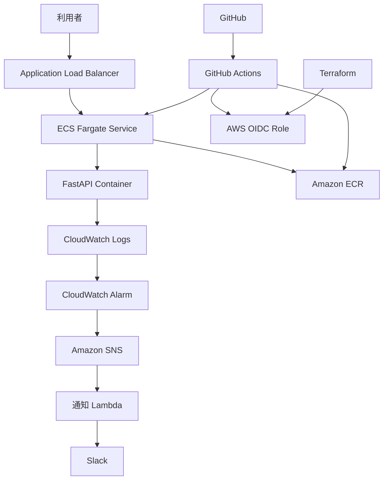

# AWS Cloud Monitoring & Auto Recovery Platform

## 1. プロジェクト概要

FastAPI製WebアプリケーションをAmazon ECS on AWS Fargateで稼働させ、TerraformによるIaC、GitHub ActionsによるCI/CD、Amazon CloudWatchによる監視、Amazon SNS・AWS LambdaによるSlack通知を実装する学習・転職用ポートフォリオ。

### 目的
- AWS上のコンテナアプリケーションを設計・構築・運用する。
- インフラをTerraformで再現可能にする。
- GitHubへの変更を契機にテスト・イメージ作成・デプロイを自動化する。
- アプリケーションログとメトリクスを監視し、異常を通知する。
- 障害を意図的に発生させ、検知・調査・復旧までを実証する。

## 2. 主な技術

| 領域 | 技術 |
|---|---|
| Cloud | AWS |
| Compute | ECS Fargate |
| Container | Docker / Amazon ECR |
| Application | Python / FastAPI |
| Entry point | Application Load Balancer |
| Network | VPC / Public・Private Subnet |
| IaC | Terraform |
| CI/CD | GitHub Actions + OIDC |
| Logs / Metrics | CloudWatch Logs / Metrics / Alarms |
| Notification | SNS → Lambda → Slack Incoming Webhook |
| Source control | GitHub |

## 3. システム構成



> 実際の通信経路・サブネット配置・IAM権限は `docs/02_basic_design.md` と `docs/03_detailed_design.md` を参照。

## 4. リポジトリ構成（目標）

```text
aws-cloud-monitoring-platform/
├── README.md
├── docs/
│   ├── 01_requirements.md
│   ├── 02_basic_design.md
│   ├── 03_detailed_design.md
│   ├── 04_operations_design.md
│   ├── 05_test_specification.md
│   └── 06_architecture_decisions.md
├── app/
│   ├── main.py
│   ├── requirements.txt
│   └── tests/
├── Dockerfile
├── terraform/
│   ├── versions.tf
│   ├── providers.tf
│   ├── variables.tf
│   ├── main.tf
│   ├── outputs.tf
│   └── modules/
└── .github/workflows/
    ├── ci.yml
    └── deploy.yml
```

## 5. 構築の進め方

1. 要件・設計レビュー
2. FastAPIアプリとDockerfile作成、ローカルテスト
3. TerraformでVPC・ALB・ECR・ECS等を構築
4. GitHub ActionsのOIDC認証とCI/CD構築
5. CloudWatch Logs・Alarm・SNS・Lambda・Slack連携
6. 正常系・異常系テスト
7. README、構成図、テスト証跡、コスト見積もりを整備

## 6. 前提・注意事項

- 本書は初期設計案。AWSアカウント・利用リージョン・料金・サービス仕様を確認してから適用する。
- 初期リージョンは東京 `ap-northeast-1`。
- 本番環境ではなく、個人学習用の検証環境を想定する。
- FargateタスクはPrivate Subnetに配置し、ALBのみPublic Subnetに配置する。
- NAT Gatewayは継続課金が発生するため、初期案ではECR API/Docker、CloudWatch Logs等のVPC Endpointを利用し、アプリケーションからインターネットへの直接通信を原則不要とする。外部通信が必要になった場合はNAT等を別途設計する。
- Slack通知LambdaはVPCに配置せず、SNSから起動してSlackのWebhookへHTTPS送信する。Webhook URLはSecrets Manager等で保護する。
- 高可用性の設計と、実際に常時2タスクを稼働させるかは分けて考える。検証時はDesired Countを1にしてコストを抑え、必要に応じて2へ拡張する。
- `terraform destroy` の前に対象リソース・データ消失を確認する。ECRイメージ、ログ、Secrets等の保持方針を明確にする。

## 7. 成果物として公開するもの

- 要件定義・基本設計・詳細設計・運用設計・テスト仕様
- TerraformコードとGitHub Actionsワークフロー
- アプリケーションソースコードとDockerfile
- アーキテクチャ図
- テスト結果・障害通知のスクリーンショット（秘密情報・アカウント情報はマスキング）
- 概算コストと、コスト削減のための停止・削除手順
# aws-portfolio-spec
